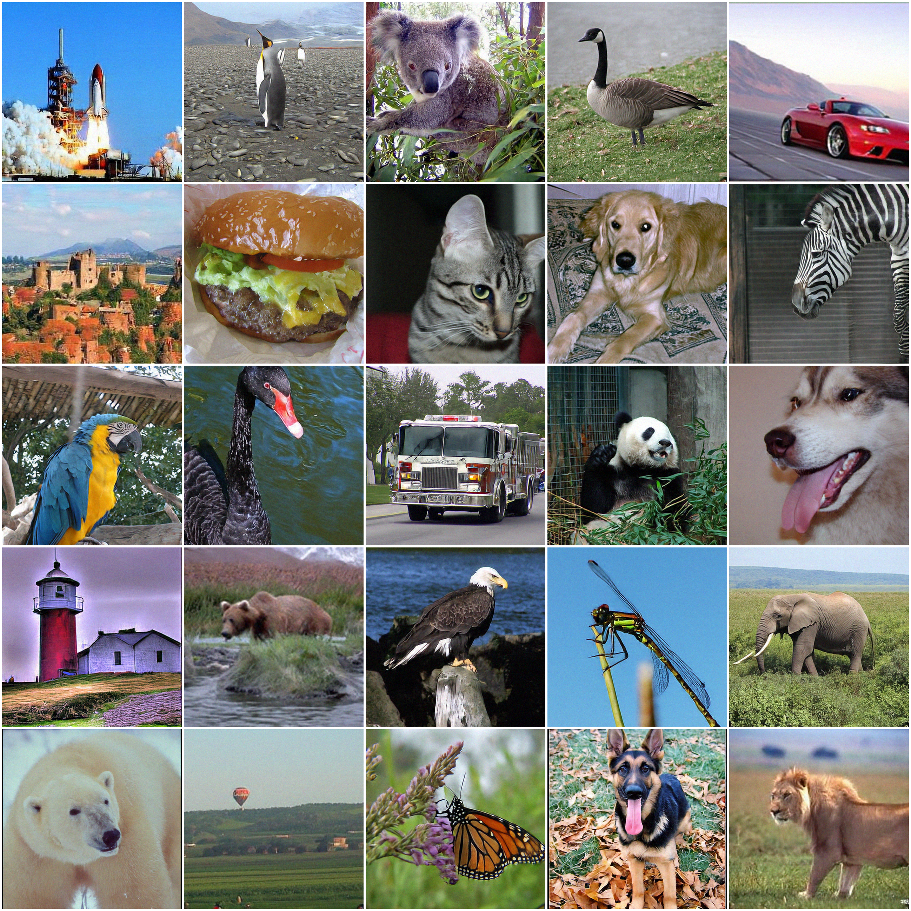
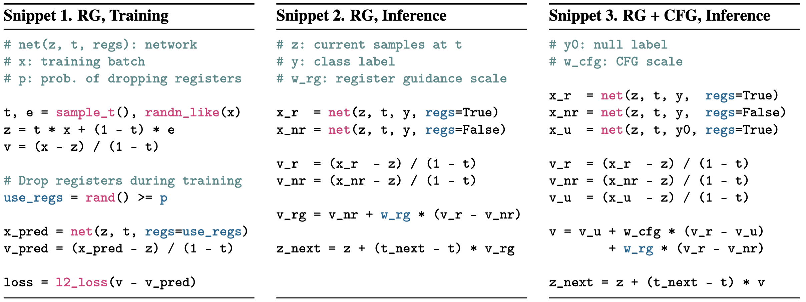

# Register Guidance for Pixel-space Diffusion (JiT)

[[project page]](https://quickjkee.github.io/registers-project-page/) [[arXiv]](https://arxiv.org/pdf/2605.16147) [[Twitter]](https://x.com/NikStarodub/status/2077675854843294137?s=20)

<p align="center">
  
</p>

This is a PyTorch/GPU implementation of the paper [Registers Matter for Pixel-Space Diffusion Transformers](https://arxiv.org/pdf/2605.16147),
where we propose Register Guidance, a technique that amplifies the signal from register tokens and thereby improves generation quality.

<p align="center">
  
</p>

## Available Models

We provide two types of pretrained models. The first is trained from scratch using Snippet 1.
The second is fine-tuned from the pretrained [JiT checkpoints](https://github.com/LTH14/JiT) using the same training procedure, but with a
higher probability of dropping registers and for only a few epochs (~50).

| Setting | Model | FID, RG | FID, CFG+RG |
|:---|:---|---:|---:|
| Training from scratch | [JiT-B/16](https://huggingface.co/yresearch/register-guidance) | 3.46 | 3.32 |
| Training from scratch | [JiT-L/16](https://huggingface.co/yresearch/register-guidance) | 2.18 | 2.16 |
| Training from scratch | [JiT-B/32](https://huggingface.co/yresearch/register-guidance) | 4.01 | 3.69 |
| Training from scratch | [JiT-L/32](https://huggingface.co/yresearch/register-guidance) | 2.47 | 2.41 |
| Fine-tuning | [JiT-B/16](https://huggingface.co/yresearch/register-guidance) | 3.25 | 2.96 |
| Fine-tuning | [JiT-L/16](https://huggingface.co/yresearch/register-guidance) | 2.00 | 2.13 |
| Fine-tuning | [JiT-H/16](https://huggingface.co/yresearch/register-guidance) | 1.85 | 1.80 |
| Fine-tuning | [JiT-B/32](https://huggingface.co/yresearch/register-guidance) | 3.62 | 3.34 |
| Fine-tuning | [JiT-L/32](https://huggingface.co/yresearch/register-guidance) | 2.24 | 2.23 |
| Fine-tuning | [JiT-H/32, RG](https://huggingface.co/yresearch/register-guidance) | 2.01 | -- |
| Fine-tuning | [JiT-H/32, CFG](https://huggingface.co/yresearch/register-guidance) | -- | 1.87 |


## Evaluation

Evaluate a pretrained JiT-B/16 (or JiT-B/32) with Register Guidance training (snippet 1)

RG setup (snippet 2)
```
torchrun --nproc_per_node=8 --nnodes=1 --node_rank=0 \
main_jit.py \
--model JiT-B/16 (or JiT-B/32) \
--img_size 256 (or 512) --noise_scale 1.0 (or 2.0) \
--gen_bsz 256 --num_images 50000 \
--guidance_type rg \
--rg 3.5 \
--interval_min_rg 0.03 --interval_max_rg 0.9 \
--output_dir output \
--resume ${CKPT_PATH} \
--in_context_start 4 \
--in_context_len 32 \
--evaluate_gen
```

CFG + RG setup (snippet 3)
```
torchrun --nproc_per_node=8 --nnodes=1 --node_rank=0 \
main_jit.py \
--model JiT-B/16 (or JiT-B/32) \
--img_size 256 (or 512) --noise_scale 1.0 (or 2.0) \
--gen_bsz 256 --num_images 50000 \
--guidance_type cfg_rg \
--cfg 2.0 --rg 1.8 \
--interval_min 0.1 --interval_max 1.0 \
--interval_min_rg 0.1 --interval_max_rg 1.0 \
--output_dir output \
--resume ${CKPT_PATH} \
--in_context_start 4 \
--in_context_len 32 \
--evaluate_gen
```


Evaluate a pretrained JiT-L/16 (or JiT-L/32) with Register Guidance training (snippet 1)

RG setup (snippet 2)
```
torchrun --nproc_per_node=8 --nnodes=1 --node_rank=0 \
main_jit.py \
--model JiT-L/16 (or JiT-L/32) \
--img_size 256 (or 512) --noise_scale 1.0 (or 2.0) \
--gen_bsz 256 --num_images 50000 \
--guidance_type rg \
--rg 2.8 \
--interval_min_rg 0.03 --interval_max_rg 0.9 \
--output_dir output \
--resume ${CKPT_PATH} \
--in_context_start 8 \
--in_context_len 32 \
--evaluate_gen
```

CFG + RG setup (snippet 3)
```
torchrun --nproc_per_node=8 --nnodes=1 --node_rank=0 \
main_jit.py \
--model JiT-L/16 (or JiT-L/32) \
--img_size 256 (or 512) --noise_scale 1.0 (or 2.0) \
--gen_bsz 256 --num_images 50000 \
--guidance_type cfg_rg \
--cfg 1.6 --rg 1.4 \
--interval_min 0.1 --interval_max 1.0 \
--interval_min_rg 0.1 --interval_max_rg 1.0 \
--output_dir output \
--resume ${CKPT_PATH} \
--in_context_start 8 \
--in_context_len 32 \
--evaluate_gen
```

Evaluate a pretrained JiT-H/16 (or JiT-H/32) with Register Guidance training (snippet 1)

RG setup (snippet 2)
```
torchrun --nproc_per_node=8 --nnodes=1 --node_rank=0 \
main_jit.py \
--model JiT-H/16 (or JiT-H/32) \
--img_size 256 (or 512) --noise_scale 1.0 (or 2.0) \
--gen_bsz 256 --num_images 50000 \
--guidance_type rg \
--rg 2.6 \
--interval_min_rg 0.03 --interval_max_rg 0.9 \
--output_dir output \
--resume ${CKPT_PATH} \
--in_context_start 10 \
--in_context_len 32 \
--evaluate_gen
```

CFG + RG setup (snippet 3)
```
torchrun --nproc_per_node=8 --nnodes=1 --node_rank=0 \
main_jit.py \
--model JiT-H/16 (or JiT-H/32) \
--img_size 256 (or 512) --noise_scale 1.0 (or 2.0) \
--gen_bsz 256 --num_images 50000 \
--guidance_type cfg_rg \
--cfg 1.4 --rg 1.1 \
--interval_min 0.1 --interval_max 1.0 \
--interval_min_rg 0.1 --interval_max_rg 1.0 \
--output_dir output \
--resume ${CKPT_PATH} \
--in_context_start 10 \
--in_context_len 32 \
--evaluate_gen
```


## Training from scratch

Download [ImageNet](http://image-net.org/download) dataset, and place it in your `IMAGENET_PATH`.

Example script for training JiT-B/16 (or JiT-B/32) on ImageNet 256x256 for 600 epochs:
```
torchrun --nproc_per_node=8 --nnodes=1 --node_rank=0 \
main_jit.py \
--model JiT-B/16 (or JiT-B/32) \
--img_size 256 (or 512) --noise_scale 1.0 (or 2.0) \
--gen_bsz 256 --num_images 50000 \
--guidance_type cfg_rg \
--p_drop_registers 0.03 \
--cfg 2.0 --rg 1.8 \
--interval_min 0.1 --interval_max 1.0 \
--interval_min_rg 0.1 --interval_max_rg 1.0 \
--in_context_start 4 --in_context_len 32 \
--output_dir ${OUTPUT_DIR} \
--resume ${OUTPUT_DIR} \
--data_path ${IMAGENET_PATH} \
--online_eval
```

Example script for training JiT-L/16 (or JiT-L/32) on ImageNet 256x256 for 600 epochs:
```
torchrun --nproc_per_node=8 --nnodes=1 --node_rank=0 \
main_jit.py \
--model JiT-L/16 (or JiT-L/32) \
--img_size 256 (or 512) --noise_scale 1.0 (or 2.0) \
--gen_bsz 256 --num_images 50000 \
--guidance_type cfg_rg \
--p_drop_registers 0.03 \
--cfg 1.6 --rg 1.4 \
--interval_min 0.1 --interval_max 1.0 \
--interval_min_rg 0.1 --interval_max_rg 1.0 \
--in_context_start 8 --in_context_len 32 \
--output_dir ${OUTPUT_DIR} \
--resume ${OUTPUT_DIR} \
--data_path ${IMAGENET_PATH} \
--online_eval
```

## Fine-tuning

For fine-tuning, we used pretrained checkpoints from [JiT](https://github.com/LTH14/JiT)
and the same training code, but with a larger register drop probability and a lower LR.

```
torchrun --nproc_per_node=8 --nnodes=1 --node_rank=0 \
main_jit.py \
--model JiT-B/16 (or JiT-B/32) \
--img_size 256 (or 512) --noise_scale 1.0 (or 2.0) \
--gen_bsz 256 --num_images 50000 \
--blr 1e-5 \
--guidance_type cfg_rg \
--p_drop_registers 0.3 \
--cfg 2.0 --rg 1.8 \
--interval_min 0.1 --interval_max 1.0 \
--interval_min_rg 0.1 --interval_max_rg 1.0 \
--in_context_start 4 --in_context_len 32 \
--output_dir ${OUTPUT_DIR} \
--resume ${OUTPUT_DIR} \
--data_path ${IMAGENET_PATH} \
--online_eval
```

For more details, please see the paper.
